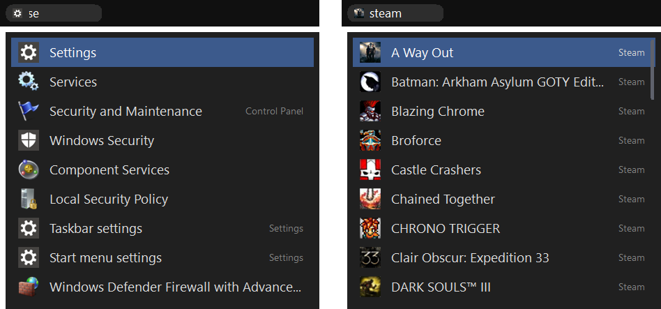

# Taskbar Launcher

A tiny app-launcher search box that lives **inside the Windows taskbar** (top or bottom), right next to the system icons.
Type a few letters, it suggests your apps with their icons, press **Enter** or click to launch.



Written in plain PowerShell + WinForms (with a bit of inline C#): nothing to install, it runs on the
PowerShell 5.1 that ships with Windows.

## Features

- **Instant search** across every Start-menu app (classic and Microsoft Store), Control Panel items (Power Options, Indexing Options...), common Settings pages (Display, Wi-Fi, Add or remove programs...) and anything in the `shortcuts` folder, each non-app result tagged with its kind. It matches the start of the
  name, any word, initials, or letters in order from the start of a word (`ntpd` > Notepad), and ignores accents. Ranking runs in C# (< 1 ms per keystroke).
- **App icons** in the suggestions, and the selected app's icon in the box itself.
- **Learns what you use**: frequently launched apps move to the top.
- **Aliases**: type `ch=chrome` then Enter, and `ch` now launches Google Chrome.
  Right-click a suggestion > *Give this app an alias*, or type `:alias` to open the alias manager (dark window: add, edit with a double-click, delete with the cross; changes are saved instantly).
- **Your own shortcuts**: drop any `.lnk`, `.url`, `.exe` or document into the `shortcuts` folder (right-click the bar > *Shortcuts*) and it shows up in the search under its file name.
  Name it like an installed app and it **replaces** that app in the search: e.g. a `Google Calendar.lnk` running
  `brave.exe --app=https://calendar.google.com/calendar/u/0/r/tasks` opens Calendar straight on Tasks.
  Keep the icons your shortcuts use in `shortcuts\.icons` (ignored by the search).
- **Empty Recycle Bin**: type `empty`, press Enter, confirm (it always asks first, even if Windows' own confirmation is turned off).
- **Games, on demand**: installed Steam and GOG games stay out of the normal results (no Elden Ring every time you type `e`).
  Type `steam ` first: `steam e` suggests Elden Ring, `steam ds` Dark Souls, and `steam ` alone lists every installed game.
  Same with `gog `. Give a game an alias to launch it directly.
- **Always up to date**: a newly installed program is searchable a few seconds after its installer finishes
  (Windows tells the bar when the Start menu changes; same for Steam and GOG games when one is installed or uninstalled; Microsoft Store apps are picked up within 30 minutes).
- Paths, URLs and commands work too.
- **Windows key**: tap it alone to open the bar instead of the Start menu (Win+E and other shortcuts still work, Ctrl+Esc opens Start).
- Works with the taskbar at the top or bottom of the screen, on the **right** (next to the clock) or the **left**
  (in place of the Start button): right-click the bar to switch.
- **Hides the Start button** to keep the taskbar clean; the Start menu still opens with **Ctrl+Esc**.
- Stays on top of the taskbar (even when the Start menu opens) and repositions itself when the
  taskbar or screen changes.
- Hides with the taskbar when an app goes full screen (videos, games, slideshows) and comes back afterwards.
- Restarts automatically if it is ever closed by accident.
- **Doesn't need Windows Search**: it reads the Start menu app list directly, so it keeps working with
  the Windows Search service (indexing) disabled.

## Install

1. Download the repo (*Code > Download ZIP*) and unzip it anywhere.
2. Right-click `Install.ps1` > **Run with PowerShell**. No admin rights needed.

This registers a per-user scheduled task named `LauncherBar` that starts the bar at logon and checks
every 5 minutes that it is still running (no console window flashes).

**Moved the folder?** Just double-click `Start Bar.bat` in its new location: it notices the task points
to the old folder and re-registers it from the new one.

**Uninstall**: right-click the bar > *Quit*, then run

```powershell
Unregister-ScheduledTask -TaskName LauncherBar -Confirm:$false
```

If you quit the bar from its menu, it stays closed until the next reboot, or until you double-click `Start Bar.bat`.

## Usage

| Action | Key |
|---|---|
| Focus the bar | click it or tap **Windows** |
| Open the real Start menu | **Ctrl+Esc** |
| Windows shortcuts (**Win+E**, **Win+D**, **Win+L**...) | still work as usual: the bar only opens when **Windows** is tapped alone |
| Move through suggestions | **Up / Down** |
| Launch | **Enter** or click a suggestion |
| Clear | **Ctrl+Space** (stay in the bar) or **Esc** (clear and go back to the previous window); Ctrl+Backspace deletes the last word |
| Search your games | `steam ` or `gog ` then the name (`steam elden`) |
| Create an alias | `alias=app name`, then Enter |
| Manage aliases | `:alias`, or right-click the bar > *Aliases* |
| Open the shortcuts folder | right-click the bar > *Shortcuts* |
| Move the bar left / right | right-click the bar > *Move to left* / *Move to right* |
| Quit the bar | right-click the bar > *Quit* |
| Reopen the bar | double-click `Start Bar.bat` |

## Settings

At the top of `LauncherBar.ps1`:

```powershell
$Width       = 110     # width of the search bar (logical pixels)
$RightMargin = 290     # only used if the clock / tray area can't be found
$WindowsKey  = $true   # tap the Windows key alone to open the bar instead of the Start menu
$HideStartButton = $true   # hide the taskbar's Start button (Ctrl+Esc still opens the Start menu)
```

The left / right position is chosen from the right-click menu and saved in `%APPDATA%\Launcher\settings.json`.
On the left, the Start button is always hidden (the bar takes its place). It comes back when the bar is closed.

## Files

| File | Purpose |
|---|---|
| `LauncherBar.ps1` | the search box in the taskbar |
| `LauncherCore.ps1` | app list, search engine (C#), aliases, usage history, launching, alias manager window |
| `Install.ps1` | registers the scheduled task and starts the bar |
| `Start Bar.bat` | reopens the bar (double-click), even after *Quit*, and repairs the task if the folder was moved |
| `shortcuts/` | your own shortcuts and files, searchable by file name, and `shortcuts/.icons` for their icons (the folders ship empty: their content stays personal) |
| `alias.txt` | your aliases, created on first run (not versioned) |

Usage history (`history.json`) and the log (`bar.log`) live in `%APPDATA%\Launcher`.
The log records starts, stops, every launch and any launch error, which is the first place to look if something doesn't open.

## Troubleshooting

- **A suggestion shows up but clicking it does nothing**: run `Install.ps1` again (or double-click `Start Bar.bat`),
  then check `%APPDATA%\Launcher\bar.log` for a `Launch:` or `Launch failed:` line.
- **Nothing happens when double-clicking `Start Bar.bat`**: the bar may already be running (only one instance runs at a time);
  look for it in the taskbar (next to the clock, or on the left).
- **Two apps with the same name** (for example the same web app installed in two browser profiles): only one is listed.
  Rename one of their Start menu shortcuts (e.g. "Gemini (Work)"): the bar picks it up a few seconds later.

## How it works (for the curious)

- Apps come from `Get-StartApps` and are launched through `shell:AppsFolder\<AppID>`, which covers
  both desktop and Store apps.
- Icons are fetched with `IShellItemImageFactory` on the same `shell:AppsFolder` items, alpha channel kept.
- The box is a borderless WinForms window owned by `Shell_TrayWnd`, so Windows keeps it above the taskbar.
- The suggestion list is a `WS_EX_NOACTIVATE` window that also answers `WM_MOUSEACTIVATE` with `MA_NOACTIVATE`,
  so neither typing nor clicking a suggestion ever takes the focus away from the box.
- The scheduled task doesn't run the bar itself: it asks Explorer to start it (`Shell.Application.ShellExecute`).
  A process started straight by Task Scheduler is treated as a background process and can't take the focus,
  so clicks on the bar and its suggestions would be ignored.

## License

[MIT](LICENSE)
